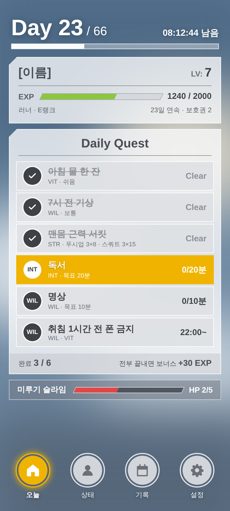
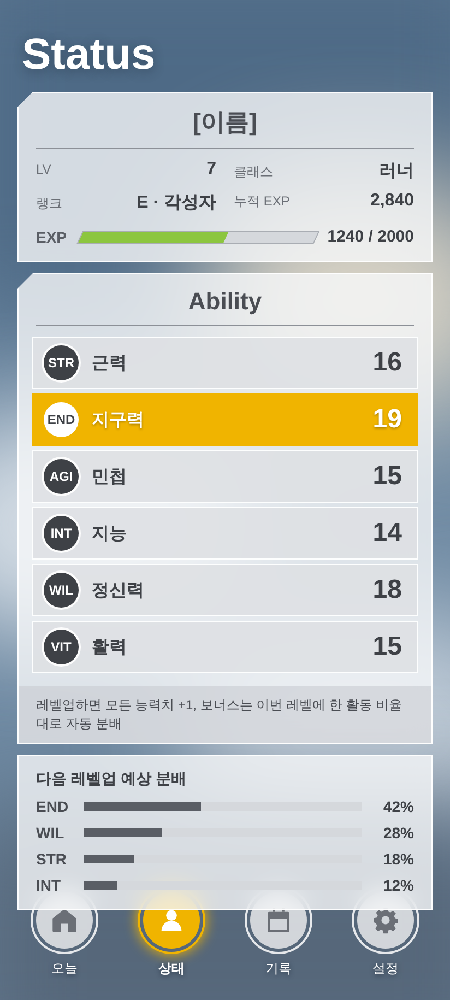
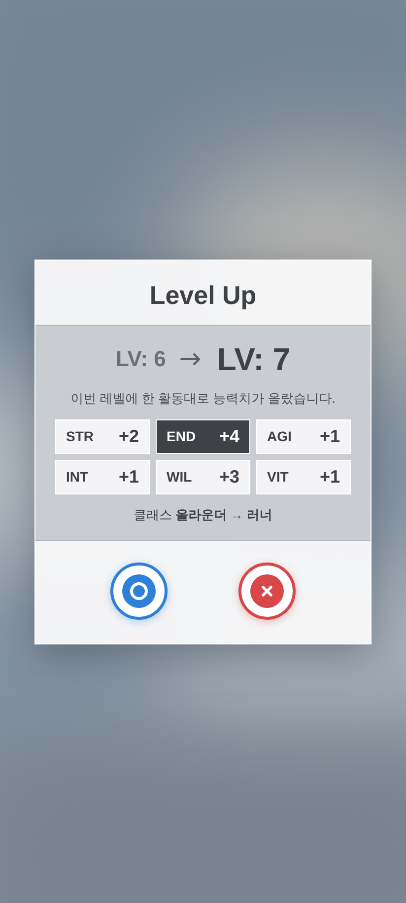
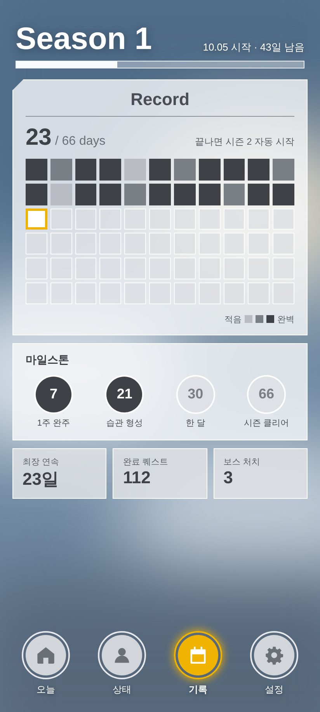

# Habit Quest

> **내가 매일 쓰려고 만든** 게임형 습관 앱.
> 66일 시즌 · 끝없는 레벨업 · 갤럭시 폴드 + 갤럭시 워치 + 내 PC 서버.

<p>




</p>

> 화면은 디자인 시안 캡처. 실기기 스크린샷으로 교체 예정 (#23)

## 왜 만들었나
습관 앱은 여러 번 깔았지만 늘 2주를 못 넘겼다. 게임처럼 레벨이 오르는 습관 앱(Life Reset 등)은 확실히 재밌었는데,
쓰다 보니 **"이건 내 생활에 맞게 내가 직접 정하고 싶다"** 는 부분이 계속 생겼다.

- 내 운동은 탁구 **또는** 러닝이고, 맨몸 근력은 주 3회 — 이런 루틴을 그대로 넣고 싶었다
- 독서 20분 목표인데 50분 읽은 날은 **더 한 만큼 보상**받고 싶었다
- 하루 빠졌다고 연속 기록이 0이 되면 그냥 그만두게 된다
- 접힌 커버 화면에서 빠르게 체크하고, 펼치면 한눈에, **손목에서도** 체크하고 싶었다
- 내 기록은 **내 PC에** 두고 싶었다

그래서 규칙부터 화면, 서버까지 **내가 매일 쓸 것**을 기준으로 직접 설계했다.

## 매일 쓰는 사람 입장에서 정한 원칙
| 원칙 | 구현 |
|---|---|
| 매일 입력은 0 | 퀘스트를 요일과 함께 한 번만 만들면 매일 자동으로 뜬다. 할 일은 탭 한 번 |
| 완벽을 강요하지 않는다 | 80%만 해도 연속 유지, 7일마다 보호권, 끊긴 다음 날 회복 퀘스트 |
| 더 하면 더 준다 | 목표 초과 비율만큼 EXP (최대 2배), 끝난 뒤에도 양 추가 가능 |
| 내가 한 대로 캐릭터가 자란다 | 포인트를 찍지 않는다. 그 레벨 동안 실제로 한 활동 비율대로 능력치 자동 분배 |
| 66일 뒤에도 계속 | 시즌 2, 3 … 자동 연장, 레벨은 끝없이 |
| 기기 어디서든 | 폴드 커버(1화면) / 펼침(2화면) / 갤럭시 워치 |
| 오프라인 우선 | 폰에 먼저 저장, 서버와는 뒤에서 동기화 |
| 폰을 바꿔도 이어서 | Google 계정으로 로그인하면 서버의 내 기록과 합쳐진다 |

## 개발하면서 신경 쓴 것
- **오래 고칠 앱이라 구조부터**: 멀티모듈(화면 1개 = 모듈 1개) + convention plugin, 버전은 한 파일에서 관리
- **게임 규칙은 순수 Kotlin + 테스트 22개**: 같은 엔진을 폰과 서버가 함께 써서 계산이 항상 같다
- **기록만 저장하고 상태는 다시 계산**(이벤트 소싱): 밸런스를 바꿔도 과거 기록과 모순이 없다
- **연출은 상태 비교로**: 레벨업·랭크업·전직·보스 처치를 이전/이후 상태 차이로 만들고, 효과음과 진동을 붙임
- **내 PC가 서버**: Ktor + PostgreSQL, 포트를 인터넷에 열지 않고 Tailscale 사설망으로만 접속
- **과정을 남김**: 설계 결정(ADR), 디자인 변천사, 트러블슈팅 기록, Issues · Milestones

**기술**: Kotlin · Jetpack Compose · Room · WorkManager · Wear OS (Data Layer) · Ktor · Exposed · PostgreSQL · Tailscale
**문서**: [게임 설계](docs/game-design.md) · [아키텍처 · 설계 결정](docs/architecture.md) · [디자인](docs/design/README.md) · [개발 기록 · 트러블슈팅](docs/dev-log.md) · [서버 설치](docs/server-setup.md)

## 진행 상황
- [x] 게임 규칙 · 엔진 · 테스트
- [x] 폰 앱 (화면 5종, 연출 · 효과음, 폴드 2분할)
- [x] 워치 앱
- [x] 실기기(갤럭시 폴드) 설치 · 실행
- [ ] PC 서버 실제 구동 · 폰 동기화 (#7)
- [x] Google 로그인 + 계정별 저장 (#17)
- [ ] 시즌 티어 · 러닝 기록(Health Connect) · 클랜 · 헬스장 모드 (Backlog)

---

## 1. 파일 구조

```
habit-quest/
├─ settings.gradle.kts          모듈 목록 (-PserverOnly=true 면 서버만)
├─ build.gradle.kts             플러그인 선언만
├─ gradle/libs.versions.toml    ★ 라이브러리 버전은 전부 여기서만 바꾼다
├─ build-logic/                 공통 빌드 설정 (convention plugin)
│  └─ convention/src/main/kotlin/
│     ├─ ConventionPlugins.kt       lifereset.android.application / library / compose / feature, jvm.library
│     └─ com/lifereset/buildlogic/  SDK 버전(AppSdk), Kotlin·Compose 공통 설정
│
├─ core/
│  ├─ game/            ★ 게임 규칙 (순수 Kotlin, 안드로이드 없음, 테스트 있음)
│  │  ├─ model/        Stat, QuestDef, Completion, PlayerState, QuestText
│  │  ├─ rules/        GameRules(숫자 조정), XpCalculator, StatDistributor, Rank, PlayerClass,
│  │  │                Seasons, WeeklyBoss, StrengthProgram, RecoveryQuest
│  │  ├─ engine/       GameEngine(완료 기록 → 상태 재계산), Fx(연출 사건), FxDiff
│  │  └─ seed/         DefaultQuests (첫 실행 때 넣는 9개 퀘스트)
│  │
│  ├─ protocol/        폰·서버·워치가 주고받는 형식 (순수 Kotlin)
│  │  ├─ auth/         AuthDtos (Google 로그인 요청/응답)
│  │  ├─ sync/         SyncDtos, SyncMappers (폰 ↔ 서버)
│  │  └─ wear/         WearProtocol (폰 ↔ 워치 경로·데이터)
│  │
│  ├─ data/            폰 저장소 (Room DB, 동기화, 설정, 로그인)
│  │  ├─ auth/         GoogleSignIn (계정 선택 창 → ID 토큰)
│  │  ├─ db/           Entities, Daos, LifeResetDatabase, EntityMappers
│  │  ├─ repository/   Quest / Completion / Settings / Game 저장소
│  │  ├─ sync/         ServerApi(OkHttp), SyncManager, SyncScheduling(WorkManager)
│  │  ├─ time/         TimeProvider (자정에 날짜 바뀜 감지)
│  │  └─ DataContainer.kt  ★ 수동 DI: 앱 전체 객체를 여기서 한 번 만든다
│  │
│  └─ designsystem/    ★ 디자인 (SAO 풍 유리창 테마)
│     ├─ theme/        Color.kt(색) · Type.kt(글꼴) · Theme.kt(크기 Dimens)
│     ├─ icon/         LrIcons (SVG path 로 만든 아이콘)
│     ├─ component/    LrBackground(배경), HeroHeader, Panels(유리창), Buttons(원형 버튼·메뉴),
│     │                QuestRow, Gauges, Inputs, SystemDialog(흰 창 + ○/✕)
│     ├─ fx/           FxHost(연출 줄 세우기) + QuestClearToast, LevelUpOverlay, RankUpOverlay, NoticeOverlay, Effects
│     └─ sound/        FxSounds (효과음: res/raw 파일 또는 기본 합성음)
│
├─ feature/            화면 1개 = 모듈 1개. 화면끼리는 서로 모른다.
│  ├─ today/           오늘: Day/시즌, 레벨·EXP, 일일 퀘스트, 회복 퀘스트, 주간 보스, 완료/기록 추가 창
│  ├─ status/          상태: 레벨·클래스·랭크, 능력치 6종, 다음 레벨업 분배 예상, 레벨업 기록
│  ├─ record/          기록: 시즌 66칸 잔디, 마일스톤, 누적, 지난 시즌
│  ├─ quests/          퀘스트 목록 / 추가·수정
│  └─ settings/        이름, 배경 이미지, 효과음, 서버 주소·키, 동기화·복원
│
├─ app/                폰 앱 (조립만 한다)
│  ├─ LifeResetApplication.kt   DataContainer · 워치 전송 · 효과음 생성
│  ├─ MainActivity.kt
│  ├─ navigation/Destinations.kt  아래 메뉴 4개 + 기타 경로
│  ├─ ui/LifeResetApp.kt         ★ 배경 + 접힘(아래 메뉴)/펼침(세로 메뉴 + 2화면) 전환 + 연출 레이어
│  └─ wear/                      WearStatePublisher(폰→워치), PhoneWearListenerService(워치→폰)
│
├─ wear/               갤럭시 워치 앱 (core:game, core:protocol 만 사용)
│  ├─ data/PhoneLink.kt     데이터 레이어 받기/보내기
│  ├─ ui/WearViewModel.kt   상태 + 완료 요청 + 레벨업 감지
│  ├─ ui/WearApp.kt         화면 (EXP 원형 테두리, 퀘스트 칩, 레벨업 플래시)
│  └─ ui/WearTheme.kt
│
├─ server/             PC 서버 (Ktor + PostgreSQL)
│  ├─ config/ServerConfig.kt   환경변수 읽기
│  ├─ auth/                    GoogleTokenVerifier(토큰 검증), AuthService(사용자·세션)
│  ├─ db/                      Tables(users, sessions, quests, completions, settings), DatabaseFactory
│  ├─ store/SyncStore.kt       사용자별 push(최신 우선 저장) / pull(바뀐 것만)
│  ├─ routes/                  Routing(경로 목록), AuthRoutes(/auth/*), SyncRoutes(/sync/*, /profile)
│  └─ scripts/windows/         start-server.bat, backup-db.ps1
│
├─ docs/
│  ├─ game-design.md          게임 규칙 (EXP·스탯·랭크·클래스·연속기록)
│  ├─ architecture.md         모듈 구조와 설계 결정(ADR)
│  ├─ design/                 디자인 규칙, 변천사, 시안(HTML) + 캡처
│  ├─ dev-log.md              트러블슈팅 기록
│  ├─ google-login-setup.md   Google Cloud 에 앱 등록 (로그인 버튼이 동작하려면 필요)
│  └─ server-setup.md         Windows 서버 설치 순서
└─ .github/                   이슈·PR 템플릿
```

**의존 방향** (아래로만 흐름, 역방향 없음):

```
app ─┬─ feature:* ─┬─ core:designsystem ── core:game
     │             └─ core:data ─────────── core:protocol ── core:game
     └─ core:data
wear ── core:protocol ── core:game
server ── core:protocol ── core:game
```

`core:game` 은 폰·워치·서버가 같이 쓰므로, 규칙을 고치면 세 곳이 동시에 같은 결과를 낸다.

---

## 2. 데이터가 흐르는 방식

1. 저장하는 것은 **퀘스트 정의**와 **완료 기록**뿐이다. 레벨·능력치·클래스·연속기록은 저장하지 않고
   `GameEngine` 이 시작일부터 완료 기록을 다시 재생해서 매번 계산한다.
   → 규칙(`GameRules`)을 바꾸면 과거 기록까지 새 규칙으로 다시 계산된다.
2. 완료 탭 → Room 에 기록(dirty) → 상태 재계산 → 이전/이후 상태를 비교(`FxDiff`)해서 연출 사건 발생
   → `FxHost` 가 클리어 → 완벽한 하루 → 레벨업 → 랭크업 순서로 하나씩 보여주고 소리·진동.
3. 5초 뒤 WorkManager 가 서버에 push/pull (15분마다 한 번 더). 충돌은 `updatedAt` 이 더 최근인 쪽이 이긴다.
   서버는 `Authorization: Bearer 세션토큰` 으로 사용자를 알아보고 그 사용자의 행만 읽고 쓴다.
4. 상태가 바뀔 때마다 워치로 요약을 보낸다. 워치에서 탭하면 폰이 완료 처리 → 다시 워치로.

---

## 3. Android Studio 에서 열기

1. Android Studio (Ladybug 2024.2 이상) → **Open** → `life-reset` 폴더.
2. 처음 Sync 때 Gradle 8.11.1 / AGP 8.7.3 이 받아진다. JDK 는 Studio 내장 JBR 17 그대로.
3. 실행 구성에 `app`(폰)과 `wear`(워치)가 생긴다.

### 폰에 설치
- 폴드: 개발자 옵션 → USB 디버깅 (또는 무선 디버깅) → 실행 구성 `app` ▶.
- 커버 화면(접힘)은 아래 원형 메뉴, 펼치면 왼쪽 세로 메뉴 + 화면 두 개가 나란히 나온다(폭 600dp 기준).

### 워치에 설치
- 워치: 설정 → 디바이스 정보 → 소프트웨어 정보 → 빌드 번호 7번 탭 → 개발자 옵션 → **무선 디버깅** 켜기.
- Studio: Device Manager → **Pair Devices Using Wi-Fi** 로 워치 연결 → 실행 구성 `wear` ▶.
- 폰과 워치 앱은 `applicationId` 와 서명 키가 같아야 서로 대화한다. **같은 PC 에서 둘 다 빌드**하면 자동으로 같다.

### 게임 규칙 테스트
```
./gradlew :core:game:test
```

---

## 4. PC 서버

자세한 순서는 [docs/server-setup.md](docs/server-setup.md). 요약:

1. PostgreSQL 설치 → `lifereset` DB/사용자 생성
2. `gradlew -PserverOnly=true :server:buildFatJar` → `server/build/libs/life-reset-server.jar`
3. Google Cloud 에 웹·Android 클라이언트 등록 → [docs/google-login-setup.md](docs/google-login-setup.md)
4. jar 와 `start-server.bat` 을 `C:\life-reset\` 에 두고, bat 안의 Google 클라이언트 ID·허용 이메일·DB 비밀번호를 채운다
5. 작업 스케줄러에 "로그온 시 실행" 등록
6. Tailscale 설치 → `tailscale serve --bg 8080` → 앱 설정에 `https://PC이름.tailnet이름.ts.net` 입력 → **Google 계정으로 로그인**

---

## 5. 직접 바꾸는 법

| 바꾸고 싶은 것 | 고칠 곳 |
|---|---|
| 색 | `core/designsystem/.../theme/Color.kt` 의 `GlassColors` 한 곳 |
| 글꼴 | `res/font/` 에 폰트 파일(예: `saira_semicondensed_bold.ttf`) 넣고 `theme/Type.kt` 의 `LrFonts.Display` 를 `FontFamily(Font(R.font.…))` 로 교체 |
| 창 모서리 컷, 버튼 크기 등 | `theme/Theme.kt` 의 `Dimens` |
| 배경 | 앱 안: 설정 → **배경 이미지 고르기** (사진 선택). 기본 하늘 자체는 `component/LrBackground.kt` 의 `DefaultSky` |
| 아이콘 | `icon/LrIcons.kt` (SVG path 문자열만 바꾸면 됨). 앱 아이콘은 `app/src/main/res/drawable/ic_launcher_foreground.xml` |
| 효과음 | `app/src/main/res/raw/` 에 `sfx_quest_clear` `sfx_perfect_day` `sfx_level_up` `sfx_rank_up` `sfx_boss` `sfx_notice` 이름으로 .ogg/.mp3 를 넣으면 기본음 대신 재생 |
| 연출 | `fx/` 폴더. 새 연출: `core:game` 의 `Fx` 에 사건 추가 → `FxDiff` 에서 발생 → `FxHost` 의 `when` 에 한 줄 |
| EXP·레벨 곡선, 보너스 비율, 올라운더 기준 | `core/game/.../rules/GameRules.kt` (숫자만 모여 있음) |
| 랭크 구간·칭호 | `rules/Rank.kt` |
| 클래스 | `rules/PlayerClass.kt` |
| 근력 운동 단계 | `rules/StrengthProgram.kt` |
| 첫 실행 기본 퀘스트 | `seed/DefaultQuests.kt` (앱에서 추가·수정하는 게 보통) |

---

## 6. 나중에 붙일 기능과 자리

| 기능 | 자리 |
|---|---|
| 시즌 티어 (브론즈 IV …) | `core:game/rules/SeasonTier.kt` 새로 + `PlayerState` 에 필드 + `feature:record` 표시 |
| 러닝 기록·경로 (Health Connect) | `core:data/health/` 새 패키지 + `feature:run` 새 모듈. 기록이 들어오면 러닝 퀘스트 자동 완료 |
| 헬스장 모드 | `rules/StrengthProgram.kt` 옆에 `GymProgram.kt`, `QuestDef.programId = "gym"` |
| 클랜 | `server/routes` 에 `/clan/*`, `core:protocol/clan/`, `feature:clan` 모듈 |

새 화면 모듈 추가 = `feature/xxx/build.gradle.kts` 에 `alias(libs.plugins.lifereset.android.feature)` 한 줄 +
`settings.gradle.kts` 에 `include(":feature:xxx")` + `app/ui/LifeResetApp.kt` 에 경로 연결.
