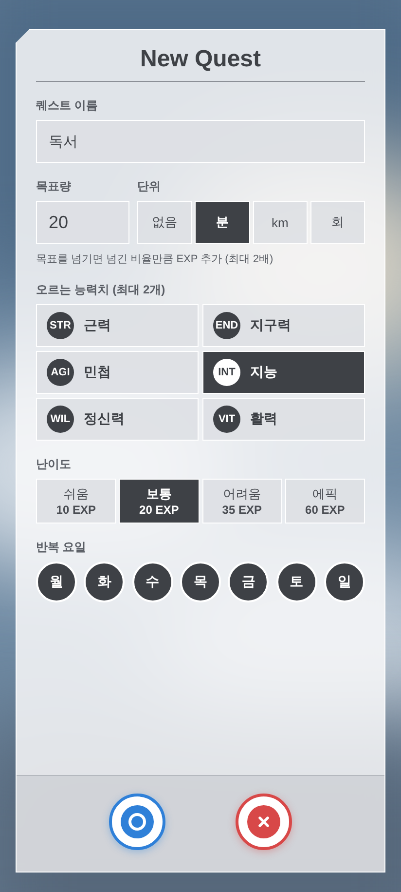
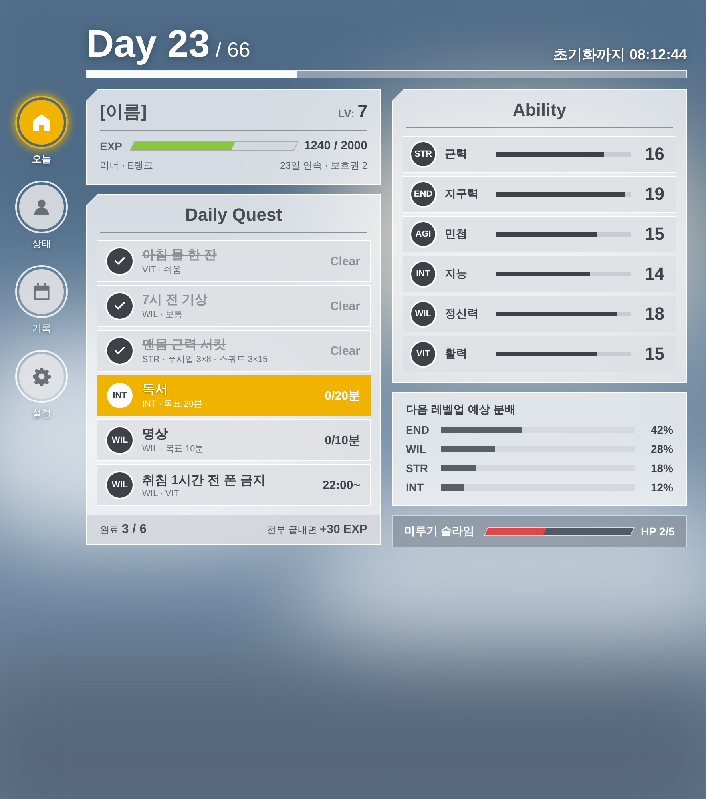
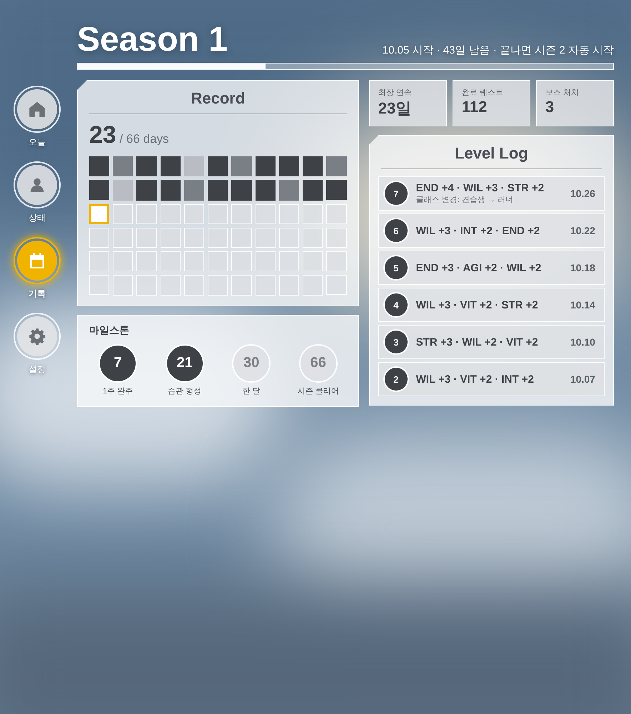

# 디자인

## 최종 방향: 하늘 위 반투명 유리창 (SAO 메뉴에서 영감)

| 오늘 | 상태 | 66일 기록 | 레벨업 | 퀘스트 등록 |
|---|---|---|---|---|
|  |  |  |  |  |

**폴드 펼침 (폭 ≥ 600dp: 세로 메뉴 + 2화면)**

| 오늘 + 상태 | 기록 + 로그 |
|---|---|
|  |  |

## 디자인 규칙
| 요소 | 규칙 | 코드 위치 |
|---|---|---|
| 배경 | 흐린 하늘 (사용자가 사진으로 교체 가능, Android 12+ 블러) | `component/LrBackground.kt` |
| 창 | 흰색 반투명 유리 `#F6F7F9 80%`, 흰 테두리, **왼쪽 위 모서리만 사선 컷** | `component/Panels.kt` |
| 메뉴 줄 | 연회색 줄 + 진회색 원형 아이콘(흰 링) | `component/QuestRow.kt`, `Buttons.kt` |
| 버튼 | 회색 원 + 흰 링. 선택된 것만 금색 + 빛 | `component/Buttons.kt` |
| 강조색 | **금색 `#F0B400` 은 "지금 할 것" 하나에만** (다음 퀘스트, 선택 메뉴, 최고 스탯) | `theme/Color.kt` |
| 알림 창 | 흰 창 + 가운데 제목 + 회색 띠 본문 + 파란 ○ / 빨간 ✕ 원형 버튼 | `component/SystemDialog.kt` |
| 글꼴 | 숫자·제목은 좁은 글꼴(condensed), 본문은 기본 글꼴 | `theme/Type.kt` |
| 하늘 위 글씨 | 흰색 + 그림자 (`Day 23 / 66`) | `component/HeroHeader.kt` |

색은 `theme/Color.kt` 의 `GlassColors` 한 곳에서만 정의한다.

## 디자인이 바뀌어 온 과정
이 디자인은 한 번에 나온 게 아니라 피드백을 거쳐 4번 바뀌었다.

1. **1차 — 어두운 "시스템 창" 스타일** (나 혼자만 레벨업 느낌)
   → 너무 어둡고 무거움. 매일 여는 앱인데 피로하다.
2. **2차 — 밝은 패널 + 주황 강조**
   → 주황이 너무 많아 어디를 봐야 할지 모르겠음.
3. **3차 — SAO 메뉴 레퍼런스 분석**
   원작 화면을 그대로 복제하는 대신 특징만 뽑아 재해석했다:
   - 모서리 한 곳만 꺾인 창 → "포인트가 모서리에 있는" 느낌
   - 창이 불투명하지 않고 뒤 배경이 비침
   - 버튼은 원형 + 회색, 선택된 것만 색
   - 경고·확인 창은 흰 창 + 회색 띠 + 파랑/빨강 원 버튼
4. **4차 (최종) — 하늘 배경 + 유리창 + 금색 한 곳**
   주황을 걷어내고, 금색은 "다음에 할 퀘스트" 한 줄에만 써서 시선이 자연스럽게 가도록 했다.

## 시안 파일
`mockups/*.dc.html` 은 HTML 로 만든 시안이다. 브라우저로 열면 그려진다 (같은 폴더의 `support.js` 가 템플릿을 채움).
`screens/*.png` 는 그 시안을 캡처한 이미지.
